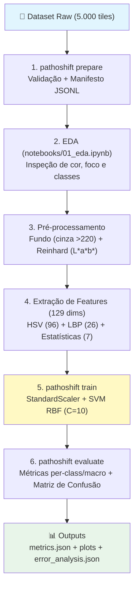

# 🔬 PathoShift Challenge: Triagem Robusta em Patologia Digital
## Trabalho Prático — Processamento de Imagens
### Entrega 1: Pathology Image Pipeline

Este repositório contém a implementação completa e modular da **Entrega 1** do PathoShift Challenge. O sistema executa controle de qualidade, normalização cromática, extração de descritores clássicos e classificação supervisionada de tecidos histopatológicos colorretais.

---

## 📌 1. Visão Geral e Dataset

O pipeline foi projetado para processar lâminas microscópicas e recortes (*tiles*) corados com **Hematoxilina e Eosina (H&E)**. Nesta primeira etapa, adotamos o benchmark **Kather Colorectal Histology**:

- **Amostras:** 5.000 imagens em formato TIFF ($150 \times 150$ pixels, 0.495 $\mu$m/pixel).
- **Balanceamento:** 625 imagens para cada uma das 8 classes biológicas.
- **Classes:**
  1. `01_TUMOR`: Epitélio adenocarcinoma colorretal.
  2. `02_STROMA`: Estroma e tecido conjuntivo.
  3. `03_COMPLEX`: Estruturas glandulares e estroma complexo.
  4. `04_LYMPHO`: Infiltrado inflamatório e linfócitos.
  5. `05_DEBRIS`: Necrose tecidual, muco e detritos celulares.
  6. `06_MUCOSA`: Mucosa colônica normal/saudável.
  7. `07_ADIPOSE`: Tecido adiposo (células de gordura).
  8. `08_EMPTY`: Fundo da lamínula de vidro (sem tecido biológico).

### 📥 Links Oficiais para Download do Dataset Completo (~258 MB)

| Fonte | Tipo | Link |
|---|---|---|
| 🏛️ **Zenodo (Oficial)** | Download Direto (.zip) | [Kather_texture_2016_image_tiles_5000.zip](https://zenodo.org/records/53169/files/Kather_texture_2016_image_tiles_5000.zip) |
| 📄 **Zenodo Record** | Página do Artigo / DOI | [DOI: 10.5281/zenodo.53169](https://doi.org/10.5281/zenodo.53169) |
| 📊 **Kaggle** | Mirror Comunitário | [Kaggle — Colorectal Histology MNIST](https://www.kaggle.com/datasets/kmader/colorectal-histology-mnist) |

---

## 🏗️ 2. Arquitetura do Pipeline



### Vetor de Características Artesanais (129 Dimensões):
1. **Histograma HSV (96 valores):** 32 bins por canal. O canal Hue separa a afinidade tintorial da Hematoxilina (DNA) e Eosina (proteínas).
2. **Local Binary Pattern - LBP (26 valores):** Textura local uniforme com raio $R=3$ e $P=24$ vizinhos circulares.
3. **Estatísticas Globais (7 valores):** Média e desvio padrão para os canais R, G, B mais a Entropia de Shannon em escala de cinza.

---

## 📁 3. Estrutura do Repositório

```
PathoShift_Challenge/
├── configs/
│   └── default.yaml                   # Hiperparâmetros de split, features e SVM
├── data/                              # Diretório para descompactação do dataset
├── docs/
│   ├── PROJECT_SPECIFICATION.md       # Enunciado oficial completo
│   └── GUIA_TIME_ENTREGA1.md          # Guia didático para o grupo e apresentação
├── notebooks/
│   └── 01_eda.ipynb                   # Análise exploratória interativa
├── outputs/                           # Destino de artefatos, métricas e gráficos
├── scripts/
│   ├── download_dataset.py            # Download e extração automática do dataset oficial
│   └── create_sample_dataset.py       # Gerador de amostras sintéticas para testes rápidos
├── src/
│   └── pathoshift/
│       ├── cli.py                     # Linha de comando oficial
│       ├── config.py                  # Dataclasses de configuração
│       ├── data/
│       │   ├── loader.py              # Leitura resiliente e particionamento estratificado
│       │   └── manifest.py            # Geração de manifesto JSONL com SHA-256
│       ├── preprocessing/
│       │   ├── quality.py             # Rejeição de fundo branco e foco por Laplaciano
│       │   └── color_norm.py          # Transferência estatística de cor de Reinhard
│       ├── features/
│       │   └── extractor.py           # Extratores de HSV, LBP e entropia
│       ├── models/
│       │   └── classical.py           # Pipeline SVM com StandardScaler
│       ├── evaluation/
│       │   ├── metrics.py             # Acurácia, F1-macro, per-class e matriz
│       │   └── error_analysis.py      # Inspeção de casos de erro com alta confiança
│       └── utils/
│           ├── reproducibility.py     # Seeds e rastreabilidade de ambiente
│           └── timing.py              # Medição de custo computacional por etapa
├── tests/
│   └── test_pipeline.py               # Suíte de testes automatizados de ponta a ponta
├── requirements.txt
├── setup.py
└── README.md
```

---

## 🚀 4. Guia Rápido: Como Clonar e Executar

### 4.1. Instalação do Ambiente
```bash
# Clone o repositório
git clone https://github.com/rodrigomotta01/Triagem-Patologia-Digital.git
cd Triagem-Patologia-Digital

# Instale os pacotes necessários
py -m pip install -r requirements.txt
py -m pip install -e .
```

---

### 4.2. Como Obter o Dataset Completo (Duas Opções)

#### Opção A: Download Automático via Script (Recomendado)
Execute o script embutido que baixa o arquivo `.zip` diretamente do Zenodo e extrai na pasta correta:
```bash
py scripts/download_dataset.py
```

#### Opção B: Download Manual
1. Baixe o arquivo `Kather_texture_2016_image_tiles_5000.zip` (~258 MB) no [Zenodo](https://zenodo.org/records/53169/files/Kather_texture_2016_image_tiles_5000.zip) ou no [Kaggle](https://www.kaggle.com/datasets/kmader/colorectal-histology-mnist).
2. Extraia o conteúdo de modo que as 8 pastas fiquem dentro de:
   ```
   data/kather_texture_2016_image_tiles_5000/
   ├── 01_TUMOR/
   ├── 02_STROMA/
   ├── ...
   └── 08_EMPTY/
   ```

*(Nota: Caso você queira apenas testar o código rapidamente sem baixar 258 MB, execute `py scripts/create_sample_dataset.py` para gerar amostras sintéticas locais).*

---

### 4.3. Interface de Linha de Comando (CLI)

Após ter os dados na pasta `data/kather_texture_2016_image_tiles_5000`:

#### 1. Inspecionar o Sistema
```bash
py -m pathoshift describe
```

#### 2. Preparar e Validar Dados (Gera o Manifesto JSONL)
```bash
py -m pathoshift prepare --input ./data/kather_texture_2016_image_tiles_5000 --output ./outputs
```

#### 3. Treinar o Pipeline Completo (Treino + Validação + Teste)
```bash
py -m pathoshift train --config ./configs/default.yaml
```

#### 4. Gerar Predições a partir de um Manifesto
```bash
py -m pathoshift predict --input ./outputs/manifest.jsonl --output ./outputs/predictions.jsonl --model ./outputs/svm_baseline.joblib
```

#### 5. Avaliar Predições
```bash
py -m pathoshift evaluate --input ./outputs/predictions.jsonl --output ./outputs/metrics.json
```

---

## 📊 5. Executar a Análise Exploratória (Notebook)

Para reproduzir os gráficos cromáticos, análises de textura e controle de qualidade para o relatório:
```bash
jupyter lab notebooks/01_eda.ipynb
```

---

## 🎓 6. Conceitos-Chave para a Defesa Técnica

- **Por que Reinhard e não Macenko no baseline?** O método de Reinhard opera diretamente no espaço L\*a\*b\* através de momentos estatísticos ($\mu, \sigma$), com custo computacional mínimo e alta estabilidade numérica para lâminas com densidade variável.
- **Por que Macro F1 é obrigatório?** Garante que o desempenho do modelo seja avaliado com o mesmo peso em todas as entidades teciduais, evitando que classes mais fáceis mascarem deficiências em diagnósticos críticos (ex: metástase tumoral).
- **Por que a semente pseudoaleatória (seed) está fixada?** Garante estrita reprodutibilidade em todas as separações estratificadas e no algoritmo de otimização de margem do SVM.
